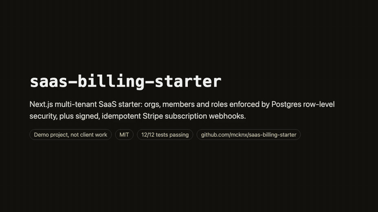
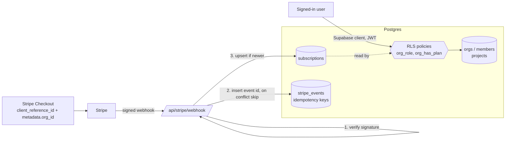

# saas-billing-starter

[](https://github.com/mcknx/saas-billing-starter/actions/workflows/ci.yml)

## Watch the 60-second demo

[](docs/demo.mp4)

[Watch the full demo (MP4, 63 s)](docs/demo.mp4): the README, the architecture diagram, the RLS policies in `db/schema.sql`, the signed + idempotent webhook and out-of-order guard in `lib/stripe-webhook.ts`, and the 12 tests passing. No audio; captions on screen.

> **Demo project, not client work.** A small, tested starting point for a multi-tenant SaaS on Next.js + Postgres (Supabase-style) with Stripe subscriptions in **test mode**. All data is fictional; there are no real Stripe keys in this repo. The tests run fully offline: Postgres is [PGlite](https://pglite.dev) in memory, and Stripe webhooks are signed locally with Stripe's own test helper.

## What it does (30 seconds)

- **Tenants:** `orgs` own everything. Users join an org through `members` with a role: `owner`, `admin` or `member`.
- **User management in the database:** Postgres row-level security decides who sees and changes what. Owners and admins invite people, only the owner changes roles, nobody can mint a second owner or delete the owner, and users of one org never see another org's rows.
- **Billing:** `POST /api/stripe/webhook` keeps a `subscriptions` row per org in sync with Stripe. It verifies the signature, records each event id once (**idempotent**), applies the record and the change in **one transaction** (so a failure lets Stripe's retry go through), and ignores **out-of-order** older events.
- **Billing gate:** RLS only lets an org create projects while its subscription is `trialing` or `active`. Cancelled orgs keep read access to their data.

## Architecture



| File | Job |
|---|---|
| `db/schema.sql` | tables, `org_role()` / `org_has_plan()` helpers, `create_org()`, every RLS policy and grant |
| `db/supabase-stub.sql` | stand-in for Supabase's `auth.uid()`, `auth.users` and `authenticated` role, only for tests |
| `lib/stripe-webhook.ts` | verify, de-duplicate and apply Stripe events; `checkoutParams()` for creating a Checkout Session |
| `lib/db.ts` | `pg` transaction helper (service-role connection) |
| `app/api/stripe/webhook/route.ts` | the Next.js route: raw body + signature header into the handler |
| `test/rls.test.ts`, `test/webhook.test.ts` | 12 tests, offline |

## Run it

```bash
npm install
npm test           # PGlite + locally signed webhooks, no network, no keys
npm run build      # Next.js production build
```

To try it against real Stripe **test mode**: copy `.env.example` to `.env.local`, apply `db/schema.sql` to your Supabase/Postgres database (Supabase already has the `auth` schema, so skip the stub), run `npm run dev`, then forward events with the Stripe CLI:

```bash
stripe listen --forward-to localhost:3000/api/stripe/webhook
stripe trigger customer.subscription.updated
```

## Real test output

```
✔ tenants are isolated: Carol (Globex) sees nothing of Acme
✔ a plain member can read the org but cannot invite people or change roles
✔ owner invites an admin; an admin can invite but cannot create a second owner or change roles
✔ billing gate: projects can only be created while the subscription is active
✔ signed-in users cannot touch billing tables directly

✔ rejects a bad signature and writes nothing
✔ checkout.session.completed links the Stripe customer to the org
✔ subscription events upsert the org's subscription, even before checkout completes
✔ idempotent: the same event delivered twice is applied once
✔ out of order: an older event cannot overwrite a newer one
✔ a failure rolls back the event record so Stripe's retry is processed
✔ checkout params carry the org id to both the session and the subscription
ℹ tests 12
ℹ pass 12
ℹ fail 0
```

`npm run build`:

```
Route (app)
┌ ○ /
├ ○ /_not-found
└ ƒ /api/stripe/webhook
```

## Choices and limits

- **RLS, not app-code checks**, so the rules hold for every client (Supabase JS, SQL editor, a future mobile app). The helpers are `security definer` so policies on `members` can look up `members` without recursing.
- **`stripe_event_created` guard** handles Stripe's out-of-order delivery for a single subscription per org. Multiple subscriptions per org would need the key on `stripe_subscription_id` instead.
- No UI for sign-in, invites or the billing page: this repo is the data model and the webhook. Supabase Auth would supply `auth.uid()` in production.
- Seat limits per plan, proration and invoices are not modelled.
- An owner can still demote themselves and leave an org without an owner; a real product should block that with a trigger.

## License

MIT
